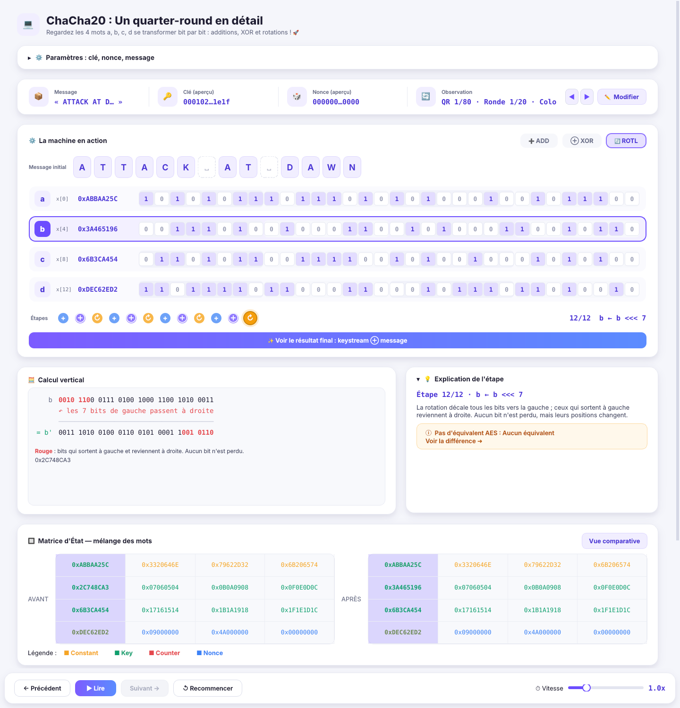
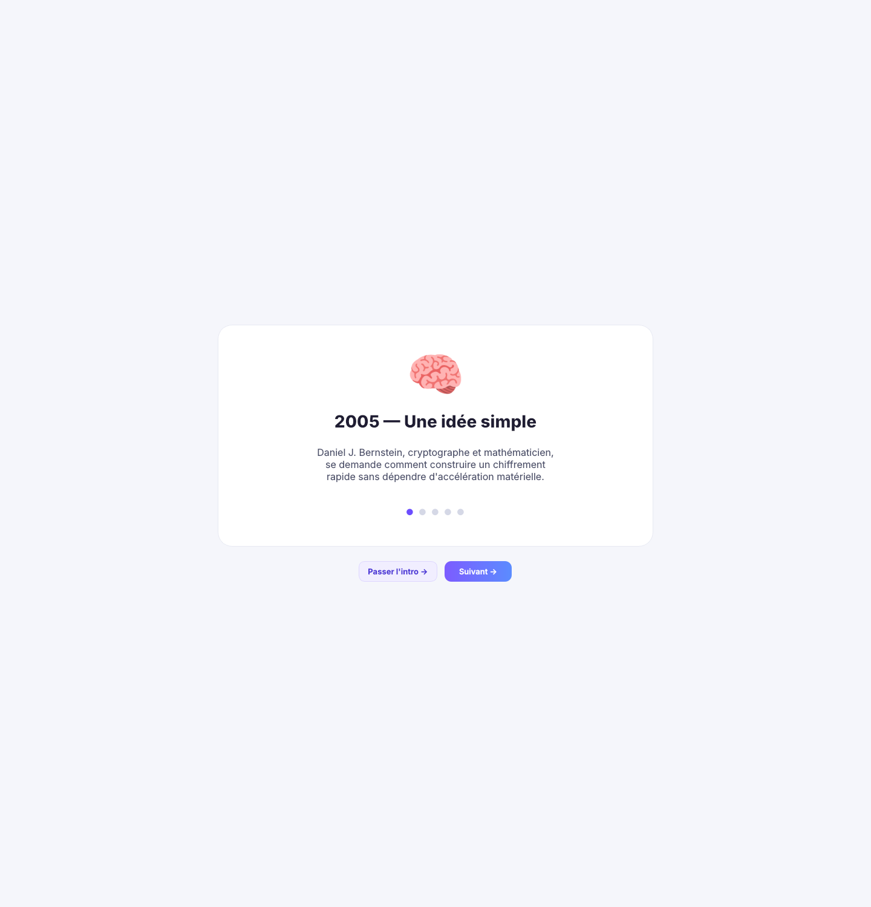
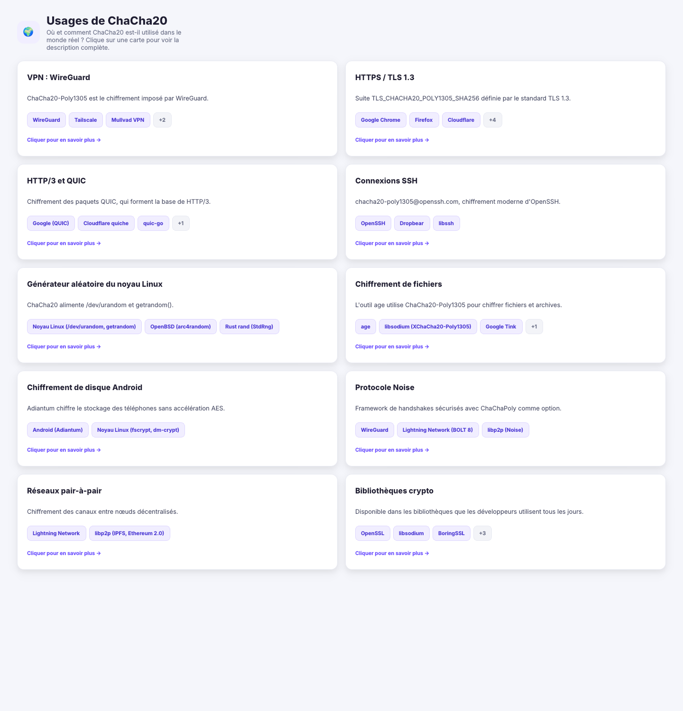
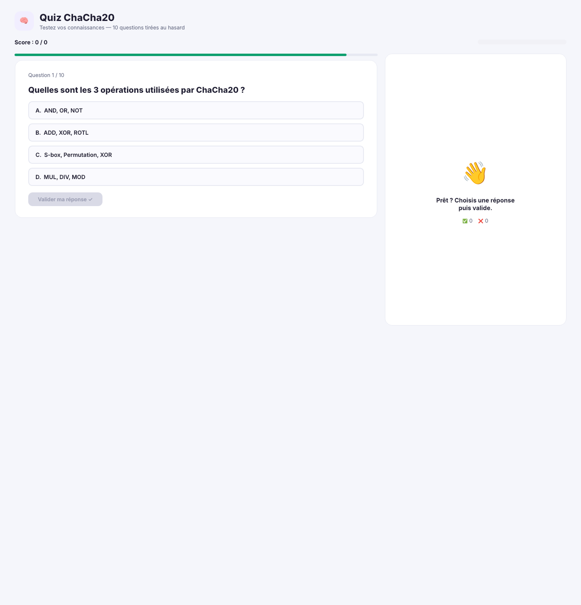
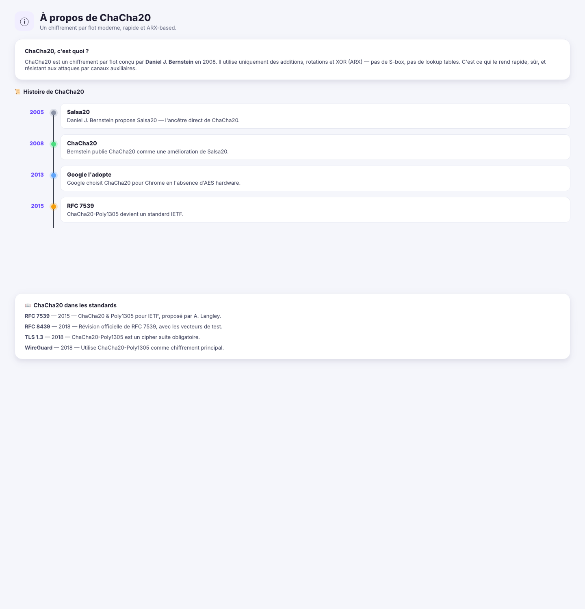

# ChaCha20 Lab

An interactive desktop app that lets you **watch ChaCha20 work, one operation at a time**.

Step through all 976 operations of a real ChaCha20 block: every `ADD`, `XOR` and `ROTL` is shown bit by bit, with the 4×4 state matrix updating live. A pure-Python implementation of [RFC 8439](https://datatracker.ietf.org/doc/html/rfc8439) powers it, verified against the official test vectors.

> The user interface is in **French** (built for a French-speaking audience), the code and this README are in English.



## Features

- **Step-by-step simulation** of a full ChaCha20 block: 20 rounds → 80 quarter-rounds → 12 operations each, plus the 16 final feed-forward additions (976 steps in total).
- **Bit-level view** of the four words `a, b, c, d` of the current quarter-round, with play / pause / previous / next / restart and a speed slider.
- **"Calcul vertical"**: each operation is laid out like a hand-written column calculation (carries dropped by `mod 2³²`, rotated-out bits highlighted).
- **State matrix** before/after each step, colour-coded: constants, key, counter, nonce.
- **Your own inputs**: edit the key (64 hex chars), nonce (24 hex chars), counter and message, with validation.
- **ChaCha20 ↔ AES comparison** for every operation: `XOR ≈ AddRoundKey`, `ROTL ≈ ShiftRows`, `ADD` has no direct AES equivalent (carries replace the S-box).
- **Real-world usages**: WireGuard, TLS 1.3, QUIC, SSH, Linux kernel RNG, and more.
- **Quiz** (18 questions) and an **About** page with a timeline (Salsa20 → ChaCha20 → RFC 8439).

| Intro | Usages |
|---|---|
|  |  |

| Quiz | About |
|---|---|
|  |  |

## How ChaCha20 works (in 30 seconds)

ChaCha20 is a stream cipher designed by Daniel J. Bernstein. It turns a 256-bit key, a 96-bit nonce and a 32-bit counter into a stream of pseudo-random bytes (the *keystream*) that is XORed with your message.

1. Build a 4×4 matrix of 32-bit words: 4 constants (`"expand 32-byte k"`), 8 key words, 1 counter, 3 nonce words.
2. Apply **20 rounds** (10 × column round + diagonal round). Each round is 4 **quarter-rounds**, each made of only three operations (**ARX**):
   ```
   a += b; d ^= a; d <<<= 16;
   c += d; b ^= c; b <<<= 12;
   a += b; d ^= a; d <<<= 8;
   c += d; b ^= c; b <<<= 7;
   ```
3. Add the original matrix to the result (feed-forward) → 64 bytes of keystream.
4. `ciphertext = plaintext ⊕ keystream` (increment the counter for each 64-byte block).

No S-box and no lookup table means it runs in constant time and is fast on CPUs without AES hardware acceleration.

## Getting started

Requires **Python 3.10+**.

```bash
git clone https://github.com/<your-username>/chacha20-lab.git
cd chacha20-lab

python -m venv .venv
source .venv/bin/activate        # Windows: .venv\Scripts\activate

pip install -r requirements.txt
python main.py
```

## Using the core without the GUI

The cryptographic core has no Qt dependency:

```python
from core.chacha20 import chacha20_encrypt, chacha20_block

key   = bytes(range(32))
nonce = bytes.fromhex("000000000000004a00000000")

ct = chacha20_encrypt(key, nonce, counter=1, message=b"ATTACK AT DAWN")
assert chacha20_encrypt(key, nonce, 1, ct) == b"ATTACK AT DAWN"   # XOR is its own inverse

block = chacha20_block(key, 1, nonce, trace=True)
print(len(block.events))        # 976 traced operations
print(block.keystream.hex())    # 64 bytes of keystream
```

## Tests

The implementation is checked against the **RFC 8439 test vectors** (§2.1.1 quarter-round, §2.3.2 block function, §2.4.2 encryption) and cross-checked against the [`cryptography`](https://cryptography.io) library on random inputs.

```bash
pytest
```

## Project structure

```
chacha20-lab/
├── main.py                  # entry point
├── core/
│   ├── chacha20.py          # RFC 8439 implementation with step tracing
│   └── operations.py        # add32 / xor32 / rotl32 and hex parsing
├── simulation/
│   └── controller.py        # Qt-independent playback controller
├── ui/                      # PySide6 interface
│   ├── main_window.py
│   ├── theme.py, widgets.py
│   ├── calc_view.py         # vertical-calculation renderer
│   ├── aes_compare.py       # ChaCha20 vs AES dialogs
│   └── pages/               # intro, simulation, usages, quiz, about
└── tests/
    └── test_chacha20.py
```

## ⚠️ Disclaimer

This is an **educational project**. The implementation prioritises clarity and traceability over speed and is **not constant-time**. Do not use it to protect real data. Use a vetted library such as `cryptography`, libsodium or your language's standard crypto package instead.

## References

- [RFC 8439: ChaCha20 and Poly1305 for IETF Protocols](https://datatracker.ietf.org/doc/html/rfc8439)
- D. J. Bernstein, [*ChaCha, a variant of Salsa20*](https://cr.yp.to/chacha/chacha-20080128.pdf) (2008)
- [RFC 8446: TLS 1.3](https://datatracker.ietf.org/doc/html/rfc8446)

## Author

**Hosni Zaaraoui**: Master's student in Systems Administration, Security & Cloud Computing.
[LinkedIn](https://www.linkedin.com/in/hosni-zaaraoui) · [GitHub](https://github.com/hosnizaaraoui)

## License

Released under the [MIT License](LICENSE).
